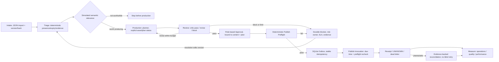

# CIA Control Plane v2 — architecture and design

## Scope and evidence boundary

Reviewer-ready local CLI scaffold; **not production-ready**. Design reference: [CIA design artifact, version 4](https://app.clickup-stg.com/333/artifact/ad-7569021?version=4), marked DESIGN NOT LIVE. The PDF/PNG/SVG exports in this directory are included unchanged from the parent design work. Implementation follows the nine-stage concept but differs where marked below. Inspiration from the supplied Maestro summary is a control pattern, not a claim that its code was re-reviewed or integrated.

Historical context in the assignment (prior unposted-brief counts, missing owner/access, pending approvals, expired Drive token and seasonal content) is not verified as current. No historical record is imported. The supplied dossier and policy are invented demo data with reserved `.invalid` links and `demo-*` names.

## Nine-stage flow

The diagram is conceptual. In this code, `Engine.publish()` is an explicit local worker operation; no background worker/cron is included. Both the demo clock and publisher are explicitly simulated.

## Two independent eligibility gates

### Early triage

1. Deterministic presence validator checks not-expired content, evidence source availability and checked-at freshness, and non-empty intake copy.
2. A separate simulated semantic call judges relevance/worthwhile production. Production requires its exact current `TRIAGED` result, not merely a triage record. It is recorded as `triage_semantic`; it cannot change deterministic findings, account permissions, or publish eligibility.
3. Triage intentionally does **not** require a ready asset, authorized publishing account, final disclosure, or final approval.
4. `risk_flags.sensitive=true` stops before any model call. It cannot be removed through ordinary `edit`/blocker resolution. Preflight also hard-fails it.

### Publication preflight

A deterministic check immediately before scheduling and again at execution validates:

- Accountable owner; asset status `ready` with referenced asset; explicit authorized brand account, identified role-backed account-owner approval and authorization reference; personal accounts are disallowed.
- Exact current content version/hash and production revision/plan hash have the necessary approving roles. Founder and paid are separate categories; both approvals are required if both flags are present. Paid also requires separate evidenced budget-owner spend authorization, amount within cap.
- Valid policy-horizon due time, platform allowlist, claims review plus deterministic claim/source-reference presence, required consent, AI disclosure, and non-sensitive status.

A human can approve a reviewed plan but **cannot** override a failed preflight. Editing during blocker resolution changes version/hash, cancels scheduled work and invalidates the old plan/approval; re-triage, re-production/review and approval are required.

## Production, semantic judgment, and budgets

- The simulator performs one structured planner and one structured critic call per revision maximum. The critic's `pass`, `revise`, or `block` is explicitly a *simulated semantic judgment*. It is not the deterministic presence validator.
- `revise` routes to `REWORK` until the configured `max_revisions`; exhaustion creates a durable blocker with reason and content-owner role. `block` records a reasoned blocker. Every model call is recorded with version, revision, stage and request/response hashes.
- Total per-record model budget counts triage, planner, critic, all revisions, and failed/reserved calls. Daily cap counts all stages. SQLite `BEGIN IMMEDIATE` protects reservation/call counts.
- No model output can grant authorization, approve, bypass policy, publish, or trigger trust promotion. Source context is quoted as untrusted data. Simulated planner does not generate an image/video asset.

## Durable blocker and escalation model

A blocker stores `code`, reason/description, record version, owner role, optional named role assignee, due time, escalation target, status, resolution evidence, resolver, and timestamps. `resolve_blocker` verifies the configured role identity and logs evidence; if patching the dossier, the canonical version/hash increments and previous approvals become stale. An absent accountable owner is deliberately unassigned, resulting in `operator_assignment_required`. `escalation_queue()` returns unassigned/overdue rows and `message_sent:false`; it sends no message and invents no actual assignment. `sensitive_hard_lock` blockers cannot be resolved through this workflow.

## WIP, approvals, outbox and state transitions

- WIP default is 3 active records in production/rework/review/block and publish through `UNKNOWN`. Intake/triage backlog is excluded. Finished receipts/dead-letter/triage-only work are not active WIP.
- Approval key binds record ID, version, content hash, revision, plan hash, approver, role and decision. Demo role membership is only an allowlist label—not authentication.
- Stable outbox idempotency key binds ID/version/hash/revision/plan/account/due time. SQLite serializes claims; terminal/claimed items do not invoke twice. Before the provider call, the execution path requires `now >= approved scheduled_at`, reruns preflight, and checks pause. Default `live_publish_enabled=false` blocks non-simulated adapters. Even enabling it does not omit execution preflight.
- `PUBLISHING` left by a process interruption or ambiguous response becomes `UNKNOWN`; only evidence-backed operator reconciliation may confirm sent or definitely-not-sent. Confirmed-sent requires a provider reference; live receipt processing additionally requires provider, provider reference and public URL. Definite failure enters dead letter. No blind retry or automatic refresh.

Main workflow states: `INTAKE`, `TRIAGE_BLOCKED`, `SENSITIVE_LOCKED`, `TRIAGED`, `NOT_WORTH_PRODUCING`, `IN_PRODUCTION`, `REWORK`, `REVIEWED`, `APPROVED`, `BLOCKED`, `PREFLIGHT_BLOCKED`, `PREFLIGHT_PASSED`, `SCHEDULED`, `PUBLISHING`, `UNKNOWN`, `PUBLISHED`, `DEAD_LETTER`. The engine validates transitions for normal state changes; canonical edits reset pre-production records to intake or route an existing plan to bounded rework.

Key event families: `intake.imported`, `triage.*`, `production.started`, `model.call_*`, `review.*`, `approval.*`, `preflight.*`, `blocker.*`, `record.edited*`, `publish.*`, `measurement.captured`, `feedback.added`, and `system.*`. Audit events are SHA-256 chained; local DB access can still alter/recreate the chain, so this is tamper-evident, not tamper-proof.

## Interfaces and synchronization boundary

`ClickUpCanonicalAdapter.fetch_record(id)` / `write_receipt(id, receipt)` define an intended future human-work-surface boundary. `PublishingAdapter.publish(record, idempotency_key)` / `reconcile(idempotency_key)` define the future publication boundary. `NotConfigured*` implementations fail closed. `SimulatedPublishingAdapter` returns `simulated:true`, `public_url:null` and a warning. It is the only wired publisher.

SQLite is canonical operational state for this starter. When opening an older v1 starter DB, legacy plans, approval records and outbox entries are renamed into `*_legacy_untrusted` tables rather than accepted as v2 decisions; records return to intake state and must be triaged/reviewed again. Legacy model-call payloads are quarantined and not replayed; count-only rows preserve prior per-record/daily budget consumption. ClickUp is an intended human work surface only after a project chooses a destination and defines authority/conflict rules. Before any adapter exists, define stable record and attachment identities, field/version authority, conflict resolution, permission scopes, approval revocation, receipt writeback, token-health semantics, and recovery procedures. No provider secrets belong in JSON; no credentials or provider connections are configured.

## Implemented / mocked / proposed matrix

| Capability | Implemented and locally testable | Mocked in this package | Proposed/not connected |
|---|---|---|---|
| Stage runtime | Nine-stage states, deterministic gates, local SQLite transactions and audit | Semantic triage/review | Production orchestration and independent review |
| Data | Version/hash canonical records, durable blockers, version invalidation | Fabricated seed evidence | ClickUp sync, attachment verification and source-of-truth contract |
| Owners | Role verification against configured allowlists, unassigned queue | `demo-*` identity fixtures | SSO/IAM, actual owner mapping and staffed escalation |
| Production | Plan/revision states; per-revision and total call budgets | Planner/critic output; no media generation | Model gateway, real asset tooling, spend/privacy/safety review |
| Preflight | Account, asset, schedule, approval, claims, consent, AI label, platform and spend checks | Demo authorization evidence | Real account grants, policy verification and token health |
| Publishing | Version-bound outbox, due-time check, pause, idempotent claim, UNKNOWN/reconcile logic | Dry-run only; no live URL or post | Real provider API, monitored background worker, real receipt/reconcile |
| Measures | Operations/quality/performance categories; missing baseline is insufficient data | Synthetic 24h/72h values | Platform analytics and channel-specific baselines |

See [`../REVIEW_GUIDE.md`](../REVIEW_GUIDE.md), [`INTEGRATION_CHECKLIST.md`](INTEGRATION_CHECKLIST.md), and [`PROVIDER_CONTRACTS.md`](PROVIDER_CONTRACTS.md).
